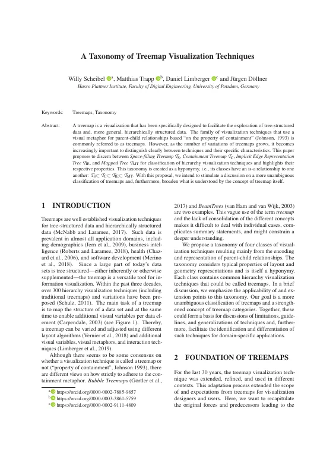
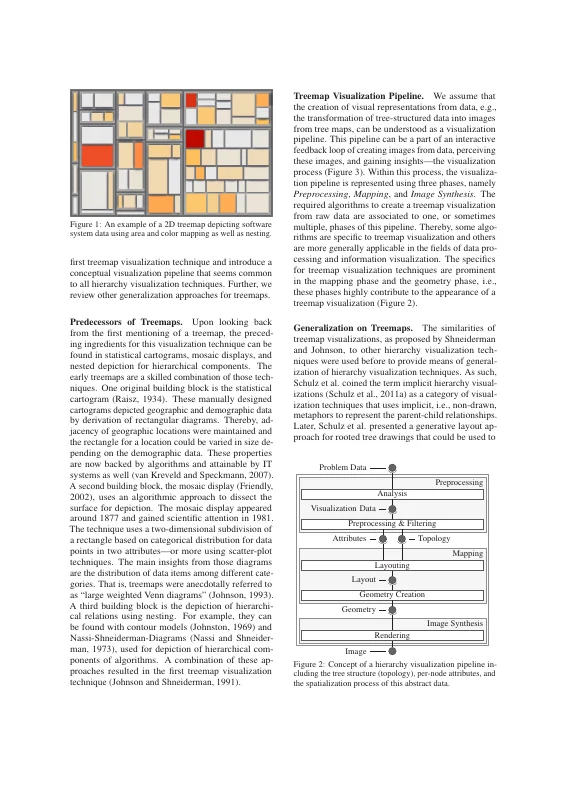
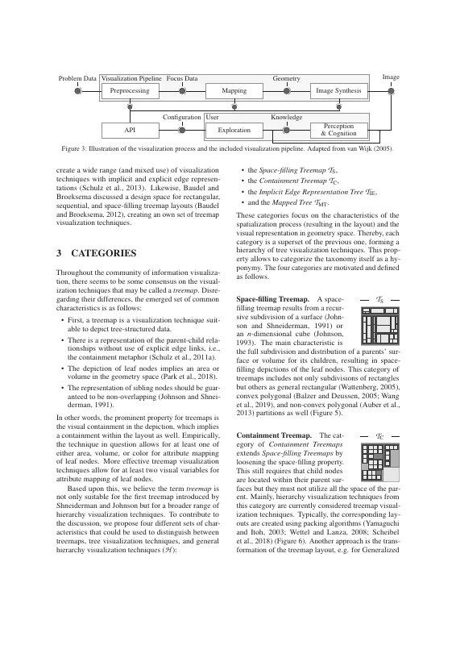
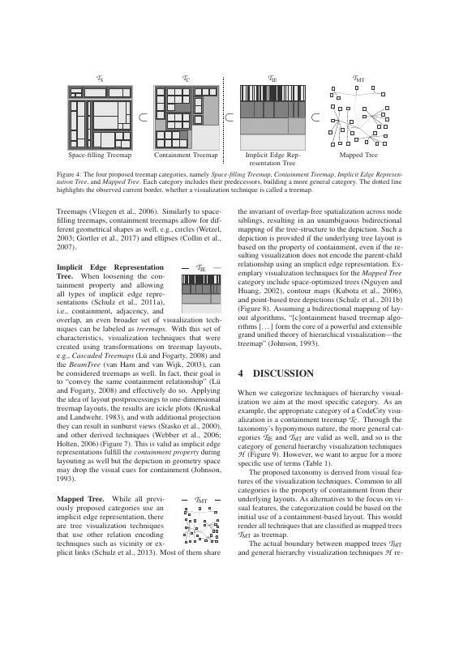
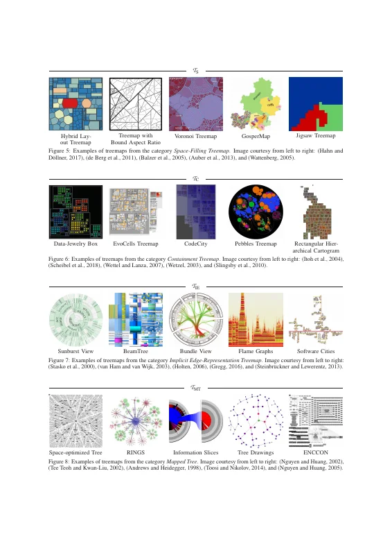
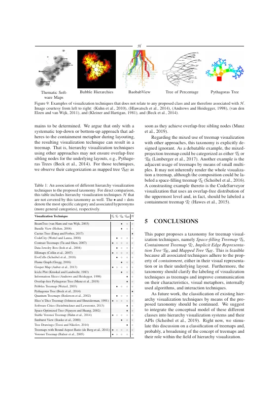
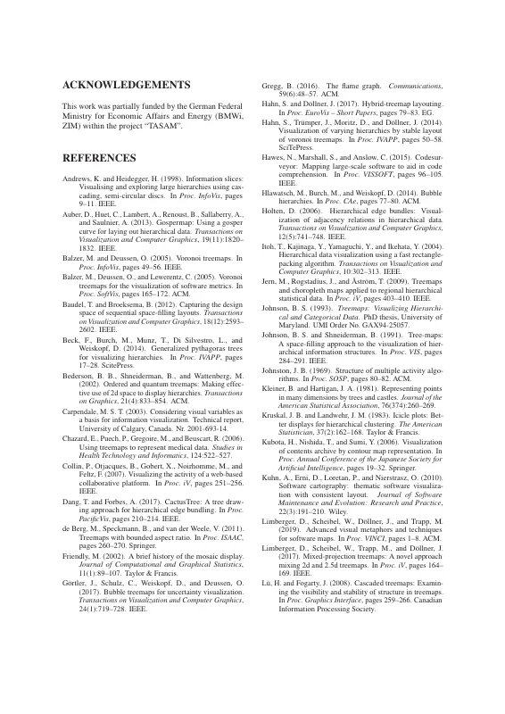
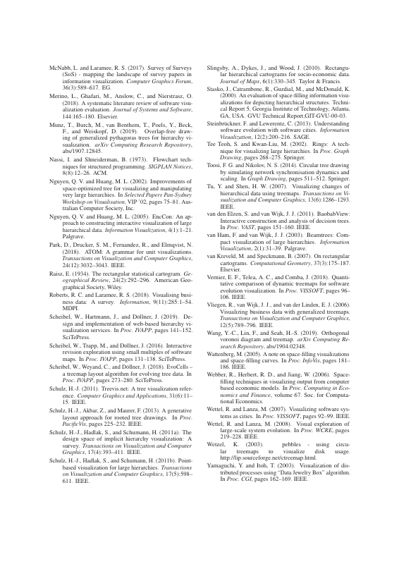

# A Taxonomy of Treemap Visualization Techniques

[Willy Scheibel](https://orcid.org/0000-0002-7885-9857), [Matthias Trapp](https://orcid.org/0000-0003-3861-5759), [Daniel Limberger](https://orcid.org/0000-0002-9111-4809), and [Jürgen Döllner](https://orcid.org/0000-0002-8981-8583)

*Proceedings of the 15th International Joint Conference on Computer Vision, Imaging and Computer Graphics Theory and Applications (IVAPP '20)*, February 27–29, 2020, Valletta, Malta. SciTePress, pp. 273–280.

[](https://doi.org/10.5220/0009153902730280) [](https://doi.org/10.5281/zenodo.24121563) [](https://www.researchgate.net/publication/338402878)

> A treemap is a visualization that has been specifically designed to facilitate the exploration of tree-structured data and, more general, hierarchically structured data.
> The family of visualization techniques that use a visual metaphor for parent-child relationships based “on the property of containment” (Johnson, 1993) is commonly referred to as treemaps.
> However, as the number of variations of treemaps grows, it becomes increasingly important to distinguish clearly between techniques and their specific characteristics.
> This paper proposes to discern between *Space-filling Treemap* 𝒯<sub>S</sub>, *Containment Treemap* 𝒯<sub>C</sub>, *Implicit Edge Representation Tree* 𝒯<sub>IE</sub>, and *Mapped Tree* 𝒯<sub>MT</sub> for classification of hierarchy visualization techniques and highlights their respective properties.
> This taxonomy is created as a hyponymy, i.e., its classes have an is-a relationship to one another: 𝒯<sub>S</sub> ⊂ 𝒯<sub>C</sub> ⊂ 𝒯<sub>IE</sub> ⊂ 𝒯<sub>MT</sub>.
> With this proposal, we intend to stimulate a discussion on a more unambiguous classification of treemaps and, furthermore, broaden what is understood by the concept of treemap itself.

<p><a href="scheibel2020-taxonomy-as-submitted.pdf"></a> <a href="scheibel2020-taxonomy-as-submitted.pdf"></a> <a href="scheibel2020-taxonomy-as-submitted.pdf"></a> <a href="scheibel2020-taxonomy-as-submitted.pdf"></a></p>
<details><summary>Remaining 4 pages</summary><p><a href="scheibel2020-taxonomy-as-submitted.pdf"></a> <a href="scheibel2020-taxonomy-as-submitted.pdf"></a> <a href="scheibel2020-taxonomy-as-submitted.pdf"></a> <a href="scheibel2020-taxonomy-as-submitted.pdf"></a></p></details>

## Contents

- [`src/`](src/) – LaTeX sources of the camera-ready version (SciTePress template), as uploaded to SciTePress (2020-01-08)
- [`scheibel2020-taxonomy-as-submitted.pdf`](scheibel2020-taxonomy-as-submitted.pdf) – camera-ready PDF built from these sources (no PDF of the submission was preserved)
- [`slides/`](slides/) – LaTeX (beamer) sources of the IVAPP 2020 talk
- [`scheibel2020-taxonomy-slides.pdf`](scheibel2020-taxonomy-slides.pdf) – talk slides built from these sources
- [`build.sh`](build.sh) – reproducible build with TeX Live 2019 (podman or docker)
- [`preview/`](preview/) – page previews for this README

## Build

```bash
./build.sh        # → build/treemap-categories.pdf
./build.sh slides # → build/slides/treemap-taxonomy-ivapp2020.pdf
```

No camera-ready PDF from the submission has been preserved; the build was verified against the publisher's PDF (SciTePress, regenerated 2022): identical text apart from the publisher's header, footer, and copyright block.
The publisher's version omits the four small category icons next to the paragraphs of Section 3 (`wrapfigure`), which this build contains.

The slides come from the talk's Git repository. Two fixes were needed to build them: the four category icons (`figures/treemap-cat-*.pdf`, excluded from that repository by a `*.pdf` ignore rule) were copied from `src/figures/`, and the file name of the treevis.net screenshot is now given as `images/treevis.net.png` (the original `images/{treevis.net}.png` no longer resolves).
The slides contain figures and screenshots of other authors' work (related-work overview), credited on the slides.

## Versions

- [`v1.0-camera-ready`](https://github.com/dl-archive/article.2020-treemap-taxonomy/tree/v1.0-camera-ready) – sources as submitted to SciTePress (2020-01-08)

## Citation

```bibtex
@InProceedings{scheibel2020-taxonomy,
  author    = {Scheibel, Willy and Trapp, Matthias and Limberger, Daniel and J{\"u}rgen D{\"o}llner},
  title     = {A Taxonomy of Treemap Visualization Techniques},
  booktitle = {Proceedings of the 15th International Joint Conference on Computer Vision, Imaging and Computer Graphics Theory and Applications},
  year      = {2020},
  series    = {IVAPP~'20},
  publisher = {SciTePress},
  pages     = {273--280},
  doi       = {10.5220/0009153902730280},
  isbn      = {978-9-897584-02-2},
}
```
